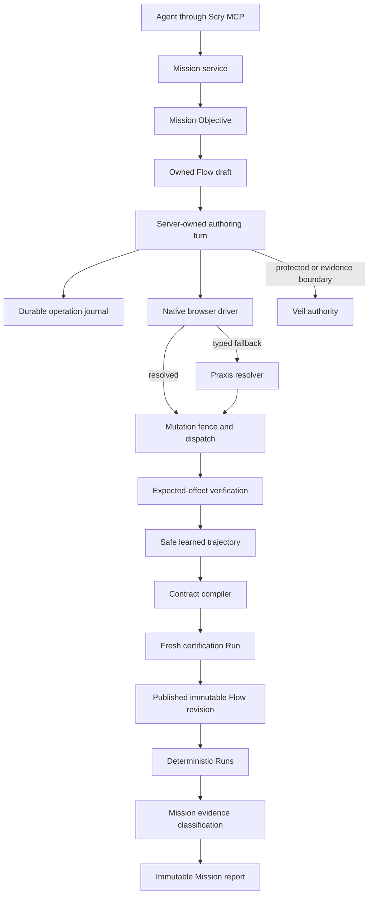

# Scry Mission-First Live Execution Convergence

Status: canonical product requirement, technical plan, and implementation runbook
Decision date: 2026-08-09
Implementation owner: Codex
Acceptance authority: live campaign evidence produced by the deployed Scry stack

This document supersedes the execution direction in:

- `docs/runbooks/adaptive-execution-foundation-m0-m5.md`;
- `docs/runbooks/adaptive-execution-m0-m1-operations.md`.

Those files remain historical evidence. They must not be used to justify mission-independent product authoring, a permanently separate direct executor, or a release without the live gates defined here.

## 1. Executive Decision

Scry will not discard its Mission, Flow, deterministic Run, Praxis, Veil, compiler, or evidence systems. It will also not promote the current direct-session service unchanged as a second production architecture.

The implementation decision is fixed:

1. A Mission is the mandatory aggregate root for all Scry testing work.
2. A Mission owns one or more Objectives.
3. Every Flow has one owning Mission and one owning Objective. No unowned Flow may be created.
4. Every authoring browser session is opened for one Mission, Objective, and Flow draft.
5. The proven readiness, semantic locator, grouped-action, origin, and secret-reference behavior from the direct lane becomes one shared `NativeBrowserDriver`.
6. Ordinary browser actions use the native driver first.
7. Praxis is invoked once, on demand, only when native semantic resolution returns a typed not-found, ambiguous, malformed-control, canvas, or application-adapter result.
8. Veil is invoked for protected input, protected acquisition, and requested evidence channels. Ordinary non-capturing navigation is not rejected merely because a Veil evidence capability is absent.
9. One durable operation journal owns dispatch state, mutation identity, expected-effect verification, recovery, and learned-record eligibility for native and Praxis actions.
10. Successful authoring trajectories compile to immutable contracts. A fresh certification Run gates publication. Accepted Runs feed the immutable Mission report.
11. The current direct endpoint remains an internal acceptance oracle only until the shared driver passes parity. It is then removed from the external MCP surface. There will not be two permanent execution engines.
12. Existing published Flow revisions continue to execute unchanged through their versioned compatibility path.

This is not claimed to work because it is architecturally plausible. Each milestone below is an explicit proof obligation. A milestone is incomplete until the exact Vitract Preview journey and four additional named live-application journeys pass through the deployed Scry product path.

### 1.1 Alternatives rejected

| Alternative                                                                                                             | Decision | Reason                                                                                                                                                                                              |
| ----------------------------------------------------------------------------------------------------------------------- | -------- | --------------------------------------------------------------------------------------------------------------------------------------------------------------------------------------------------- |
| Promote the current direct service unchanged                                                                            | Rejected | It is in-memory, returns only a bounded transcript, and bypasses Mission evidence, durable recovery, compilation, certification, deterministic Run, and reporting.                                  |
| Keep the current universal Praxis/Veil kernel on every action and add more patches                                      | Rejected | The live authentication comparison already proved readiness, resolution, admission, and mutation-classification divergence on the basic path. Another local patch would retain duplicate ownership. |
| Delete Praxis, Veil, compiler, and deterministic Runs                                                                   | Rejected | The direct lane does not provide malformed-control grounding, protected acquisition, evidence admission, immutable replay, or Mission reporting.                                                    |
| Start a third greenfield executor                                                                                       | Rejected | It would create another execution owner without live evidence and repeat the divergence problem.                                                                                                    |
| Extract the proven direct primitives into one Mission-owned native driver, with conditional Praxis and Veil authorities | Selected | It reuses measured working behavior, removes duplicate browser ownership, preserves safety and deterministic replay, and can be accepted one live-proven boundary at a time.                        |

## 2. Proven Evidence and Limits

### 2.1 Proven facts

| ID   | Fact                                                                                                                                                                                         | Evidence                                                           | Consequence                                                                                           |
| ---- | -------------------------------------------------------------------------------------------------------------------------------------------------------------------------------------------- | ------------------------------------------------------------------ | ----------------------------------------------------------------------------------------------------- |
| P-01 | The direct lane can sign in to Vitract, reach Developer Test Mode, open the documentation popup, capture a generated Test credential safely, and complete the documented order API campaign. | `docs/runbooks/evidence/direct-browser-vitract-2026-08-09.md`      | Its browser behavior is the current acceptance oracle.                                                |
| P-02 | The steady direct login/Developer journey used two client calls; grouped login, Developer navigation, and documentation popup took about 4.4-5.4 seconds after browser startup.              | Same evidence report                                               | These measurements become minimum parity targets, not anecdotes.                                      |
| P-03 | The direct lane waits for a visible document surface after `domcontentloaded`.                                                                                                               | `apps/api/src/direct-sessions/direct-session.service.ts`           | Shared readiness must preserve this behavior.                                                         |
| P-04 | Adaptive provisioning currently observes immediately after `domcontentloaded`.                                                                                                               | `apps/api/src/adaptive-sessions/adaptive-session-kernel.runner.ts` | It can observe a transient or hidden login surface and reject a valid control.                        |
| P-05 | Praxis semantic dominance considers names, labels, and expected text but omits placeholder evidence.                                                                                         | `packages/praxis/src/grounding.ts`                                 | Exact placeholder intent can remain ambiguous even when it uniquely identifies a visible input.       |
| P-06 | `NO_CAPABILITY_COMPATIBLE_CONTROL` is absent from the proven pre-dispatch failure set.                                                                                                       | `packages/executor/src/execution-kernel.ts`                        | A failure before dispatch can be recorded as an unknown mutation, forcing unnecessary reconciliation. |
| P-07 | The kernel baseline currently requires browser, Praxis, Veil, and journal for every request.                                                                                                 | `packages/executor/src/execution-kernel.ts`                        | Conditional authorities are treated as universal admission prerequisites.                             |
| P-08 | The adaptive client contract currently asks the caller for current actions, expected effects, modes, and protected references.                                                               | `packages/contracts/src/adaptive-session.ts`                       | The agent still coordinates internal browser mechanics and pays avoidable round trips.                |
| P-09 | Runs already require Mission, Objective, agent session, environment, and Flow revision. Mission reports are immutable and Mission-owned.                                                     | `apps/api/migrations/baseline.sql`                                 | The deterministic and reporting domain already supports the required hierarchy.                       |
| P-10 | Flows can currently be unowned because origin Mission and Objective are nullable.                                                                                                            | `apps/api/migrations/baseline.sql`                                 | Persistence must be tightened so product behavior matches the Mission model.                          |
| P-11 | The first repository implementation used one policy-validated executor with exact locator contracts and redaction.                                                                           | Root commit `ec5f904`                                              | Simplicity came from one execution owner, not from removing safety.                                   |

### 2.2 What is not yet proven

The following remain implementation targets until their live gates pass:

- the shared native driver behaves identically inside Mission-owned authoring;
- the native-first/Praxis-fallback policy works across malformed and modern controls;
- worker recovery preserves at-most-once mutation across both resolution paths;
- Veil evidence is consistently available or honestly classified;
- learned compilation, certification, publication, and replay work from the same trajectory;
- the Mission report correctly aggregates accepted evidence across multiple Flows and Runs;
- latency improvements survive real external applications rather than only fixtures.

No document, unit test, typecheck, synthetic fixture, or code review may convert one of these targets into a proven fact. Only the milestone's required live evidence can do so.

## 3. Product Requirements

### 3.1 Product hierarchy

The canonical hierarchy is:

```text
Project
  Mission
    Objective 1
      Flow A
        Flow revision 1..n
        Run 1..n
      Flow B
        Flow revision 1..n
        Run 1..n
    Objective 2
      Flow C
        Flow revision 1..n
        Run 1..n
    Accepted evidence
    Immutable Mission report revision 1..n
```

Definitions:

- **Mission**: the complete testing assignment, authorization scope, evidence ledger, and reporting boundary.
- **Objective**: one independently assessable outcome within the Mission.
- **Flow**: one executable pathway owned by an Objective. Multiple Flows allow alternative, setup, diagnostic, cleanup, and acceptance pathways without splitting the Mission.
- **Run**: one deterministic execution of one immutable Flow revision in one environment.
- **Accepted evidence**: a deliberate Mission classification of a Run or artifact as supporting an Objective.
- **Mission report**: an immutable synthesis of all Objectives, owned Flows, classified Runs, accepted evidence, findings, inconclusive work, and prohibited or intentionally unexecuted work.

### 3.2 Functional requirements

| ID     | Requirement                                                                                                                                                                                                                       |
| ------ | --------------------------------------------------------------------------------------------------------------------------------------------------------------------------------------------------------------------------------- |
| FR-001 | Every new Flow creation request must include an existing `missionId` and an Objective belonging to that Mission.                                                                                                                  |
| FR-002 | The API must reject a Flow, draft, authoring session, compilation, publication, or Run whose Mission/Objective/Flow ownership chain is inconsistent.                                                                              |
| FR-003 | One Mission may own multiple Objectives, each Objective may own multiple Flows, and each Flow may have multiple immutable revisions and Runs.                                                                                     |
| FR-004 | A reusable Flow may be referenced by another Mission only as an immutable imported revision. The original Flow retains exactly one owning Mission and Objective. New mutable cross-Mission Flow links are forbidden.              |
| FR-005 | The agent supplies a semantic objective, constraints, authorizations, protected references, and corrections. It does not supply CSS/XPath selectors, candidate handles, arbitrary JavaScript, secret values, or acquisition code. |
| FR-006 | One server-owned authoring turn performs readiness, native resolution, optional Praxis fallback, dispatch, expected-effect verification, journaling, and safe continuation until a typed decision boundary.                       |
| FR-007 | Exact role, label, placeholder, visible text, test ID, section, dialog, row, and live-region semantics are supported by the native driver.                                                                                        |
| FR-008 | Praxis is a fallback authority. It must not run on a standard control that the native driver resolves uniquely and safely.                                                                                                        |
| FR-009 | Veil is mandatory for protected values and requested evidence. It must not become a universal prerequisite for a non-protected, non-capturing action.                                                                             |
| FR-010 | Every mutating operation has a durable idempotency identity and a dispatch state of `not_started`, `dispatching`, `dispatched`, or `settled`.                                                                                     |
| FR-011 | A pre-dispatch rejection always produces `mutationOutcome=not_applied`. `unknown` is permitted only after dispatch began and reconciliation cannot prove the effect.                                                              |
| FR-012 | Functional result, mutation result, privacy result, evidence-channel result, and quality findings remain independent typed channels.                                                                                              |
| FR-013 | Successful, fully verified operation records may enter the learned trajectory. Failed, inconclusive, privacy-unclosed, ephemeral-only, or unknown-mutation records may not.                                                       |
| FR-014 | Publication requires a fresh successful certification Run bound to the exact compilation digest and returns the exact `compiledContractId`.                                                                                       |
| FR-015 | Mission reports include all Objectives, owned Flows, Flow revisions used, classified Runs, accepted evidence, findings, cleanup state, and safe omissions.                                                                        |
| FR-016 | The dashboard presents user outcomes, tested behavior, protected-operation status, and captured evidence before collapsed Praxis and Veil internals.                                                                              |
| FR-017 | The externally advertised MCP workflow begins with Mission creation or Mission resumption. No direct or adaptive session is advertised as mission-independent.                                                                    |
| FR-018 | Existing published revisions remain executable and report their contract/runtime version.                                                                                                                                         |

### 3.3 Non-functional requirements

| ID      | Requirement                                                                                                                                                                                            |
| ------- | ------------------------------------------------------------------------------------------------------------------------------------------------------------------------------------------------------ |
| NFR-001 | A normal authentication journey uses at most two client/MCP calls after Mission, Objective, Flow draft, environment, and credential references exist: start/resume authoring and one grouped turn.     |
| NFR-002 | No client-side sleep or queue-state polling is required. Server-side waits are bounded and phase-observable.                                                                                           |
| NFR-003 | Native resolution plus dispatch overhead is at most 1 second p95 when the document observation is current and at most 3 seconds p95 when a fresh observation is required, excluding target-side waits. |
| NFR-004 | Vitract browser startup plus login must remain at or below 10 seconds p95 in the campaign environment; the grouped login operation must remain at or below 5 seconds p95 excluding target outage.      |
| NFR-005 | Protected values are absent from MCP responses, journals, compiled contracts, logs, screenshots, video, trace, DOM, network, console, reports, and campaign artifacts.                                 |
| NFR-006 | Every requested evidence channel has exactly one terminal state: `available`, `suppressed`, `quarantined`, or `failed`.                                                                                |
| NFR-007 | No milestone is accepted from a single success. Each required live journey must pass three consecutive clean executions on the same release.                                                           |
| NFR-008 | A cleanup failure fails the campaign unless the target explicitly exposes no cleanup operation and the runbook limits the action to documented disposable Test data.                                   |
| NFR-009 | Existing deterministic Run behavior, immutable Flow revisions, and immutable Mission reports do not regress.                                                                                           |

## 4. Technical Architecture



### 4.1 Component ownership

#### Mission service

- creates and resumes Missions;
- owns Objectives, authorization records, Flow ownership, Run classification, evidence acceptance, cleanup tracking, and reports;
- rejects inconsistent ownership before browser provisioning;
- is the only product entry point for authoring.

#### Mission authoring service

- opens a durable browser session for one Mission/Objective/Flow draft;
- owns grouped turns and typed decision boundaries;
- writes all operation outcomes to the shared journal;
- emits safe trajectory records after verified success;
- survives worker lease changes without changing logical session identity.

#### Native browser driver

- is extracted from proven direct-session behavior;
- owns browser/context/page readiness, allowed-origin enforcement, popup adoption, semantic locator execution, scoped actions, bounded observations, and safe expected-effect waits;
- accepts typed operations only;
- returns typed resolution and dispatch metadata, never raw Playwright handles;
- has no Mission, compiler, Praxis, or report business logic.

#### Praxis fallback

- receives the same semantic intent after the native driver reports one admitted fallback reason;
- resolves malformed, duplicated, custom, shadow, frame, portal, canvas, and application-adapter controls;
- executes through the same mutation fence and operation journal;
- returns quality findings independently from functional success;
- is called at most once per operation unless a new document epoch is proven.

#### Veil authority

- opens and closes protected intervals;
- resolves protected references without exposing values;
- owns protected acquisition adapters and evidence admission;
- signs admitted artifact digests;
- seals or quarantines channels whose safety cannot be proven.

#### Compiler and deterministic Run

- compile only safe successful trajectory entries;
- certify an exact immutable contract on a fresh Run;
- replay the accepted contract without the authoring agent;
- preserve old contract readers for existing revisions.

### 4.2 Exact resolution algorithm

For each operation, the server executes this order:

1. Validate Mission, Objective, Flow draft, environment, authorization, operation budget, and idempotency identity.
2. Acquire or resume the durable browser lease.
3. Navigate only when the requested semantic step requires it.
4. Wait for `domcontentloaded`, then for one visible document surface: a visible form, main landmark, dialog, heading, or interactive control. Maximum wait: 5 seconds unless the Flow declares a longer target-side readiness expectation.
5. Reuse the current observation when its page, frame, URL, and document epoch remain valid. Otherwise observe once.
6. Resolve with the native driver using, in order: exact scoped role/name, exact label, exact placeholder, exact visible text, exact test ID, scoped row/section semantics, then non-exact semantic matching when the Flow explicitly allows it.
7. If exactly one visible, enabled, capability-compatible control exists, execute natively. Praxis is not called.
8. If native resolution returns `TARGET_NOT_FOUND`, `TARGET_AMBIGUOUS`, `MALFORMED_CONTROL`, `SHADOW_BOUNDARY`, `FRAME_BOUNDARY`, `PORTAL_BOUNDARY`, `CANVAS_REQUIRED`, or `APPLICATION_ADAPTER_REQUIRED`, call Praxis once with the semantic intent and the current observation identity.
9. If Praxis resolves exactly one admitted candidate, execute through the same mutation fence. If it cannot, return a typed agent decision boundary with only the distinguishing semantic facts.
10. Verify the expected effect against the resulting document epoch or durable application state.
11. Atomically settle the journal, mutation fence, typed outcomes, and learned-record eligibility.
12. Continue with the next deterministic operation in the grouped turn until completion, budget exhaustion, authorization requirement, protected binding requirement, true ambiguity, policy refusal, or unknown mutation.

There is no arbitrary fixed sleep in this algorithm. Readiness waits are semantic, bounded, and timed separately from Scry overhead.

### 4.3 Mutation semantics

| Dispatch state | Meaning                                                             | Permitted mutation outcome                                               |
| -------------- | ------------------------------------------------------------------- | ------------------------------------------------------------------------ |
| `not_started`  | No browser mutation call began.                                     | `not_applied` only                                                       |
| `dispatching`  | Durable fence acquired; browser call has not acknowledged dispatch. | `not_applied` if pre-dispatch is proven, otherwise `unknown` after crash |
| `dispatched`   | Browser action began or target accepted the request.                | `applied`, `not_applied` after reconciliation, or `unknown`              |
| `settled`      | Expected effect and mutation state were durably recorded.           | terminal recorded value                                                  |

`NO_CAPABILITY_COMPATIBLE_CONTROL`, target-not-found, target-ambiguous, stale observation, policy denial, missing protected reference, and capability admission failure are pre-dispatch and must settle `not_applied`.

Automatic retry is allowed only for a proven pre-dispatch transient failure and only once within the grouped-turn budget. `unknown` is terminal until an explicit reconciliation Flow proves the result.

### 4.4 Persistence changes

Add one forward-only migration with these exact steps:

1. Add `owner_mission_id uuid` and `owner_objective_id uuid` to `flows`, initially nullable.
2. Backfill from `origin_mission_id` and `origin_objective_id` when both form a valid Objective/Mission pair.
3. Otherwise backfill from the earliest valid `mission_flow_links.created_at` row.
4. For every remaining orphan legacy Flow, create one project-scoped Mission named `Legacy imported flows - <project id>`, create one Objective named after the Flow, and set that pair as owner. This migration-created Mission is historical compatibility data and cannot admit new Runs until explicitly reviewed.
5. For a legacy Flow linked to multiple Missions, retain the earliest link as its owner. Convert each other link into an immutable imported-revision reference owned by the consuming Mission. Do not share mutable draft state across Missions.
6. Add a composite foreign key from `(owner_objective_id, owner_mission_id)` to `mission_objectives(id, mission_id)`.
7. Set both owner columns `NOT NULL`.
8. Add a trigger rejecting ownership changes after the first Flow revision is published.
9. Add `mission_id`, `objective_id`, and `flow_draft_id` as required foreign keys on authoring/adaptive sessions and their operation journals.
10. Backfill existing active authoring records only when their current draft provides an unambiguous owner. Mark every other active record `recovery_required` with `MISSION_OWNERSHIP_RECONCILIATION_REQUIRED`.
11. Add indexes for Mission/Objective Flow listing and Mission-wide report aggregation.
12. Keep `origin_mission_id` and `origin_objective_id` readable for one compatibility release, then remove their write path. `owner_*` is authoritative immediately after migration.

The migration does not rewrite immutable Flow revision content, Run snapshots, evidence bytes, or Mission report snapshots.

### 4.5 API and MCP surface

The preferred external workflow is fixed:

```text
create_mission
add_mission_objective
create_flow_draft
start_flow_authoring
advance_flow_authoring
get_flow_authoring        # only for reconnect or explicit status request
close_flow_authoring
compile_and_certify_flow
publish_flow_draft
start_run
classify_mission_run
accept_objective_evidence
publish_mission_report
```

Contract rules:

- `create_flow_draft` requires `missionId` and `objectiveId`.
- `start_flow_authoring` requires `missionId`, `objectiveId`, `draftId`, `environmentId`, semantic objective delta, budgets, and protected-reference IDs.
- `advance_flow_authoring` accepts semantic operations or a semantic continuation instruction; the server derives current-action mechanics and expected-effect probes from the Flow draft and current state.
- A response contains completed semantic operations, compact state delta, typed outcomes, timings, and at most one decision boundary.
- It does not return the full DOM, full candidate inventory, unchanged plan, secret values, selectors, or handles.
- Fine-grained Probe and authoring tools are deleted when grouped Mission turns replace them in M2. There is no deployed compatibility period.
- `start_direct_session`, `execute_direct_turn`, `observe_direct_session`, and `close_direct_session` are deleted from API and MCP in M1 after native-driver parity passes inside the implementation branch.
- The MCP system description must state that Mission is mandatory and that Flows and Runs belong to it.

### 4.6 Hard cutover and restore

Scry has no production customer workload requiring mixed-version rollout. Every milestone therefore uses one full-stack cutover and contains no runtime path-selection feature flag.

1. Implement and verify the replacement path on the milestone branch.
2. Run native/direct or old/new parity only in isolated tests before deletion. Never ship shadow execution and never dual-execute a mutation.
3. Delete the displaced controller, service, MCP tool, environment toggle, composition branch, and tests for the old behavior in the same PR.
4. Stop API, MCP, workers, and web together.
5. Take one named development-database and artifact-store snapshot bound to the pre-cutover git commit and schema fingerprint.
6. Apply the milestone migration once.
7. Start API, MCP, workers, and web from the same immutable image/commit. Mixed milestone versions are forbidden.
8. Run readiness, production-shaped, Vitract, and four-app gates on that exact stack.
9. Keep the milestone only after all required gates pass. The new implementation is the only admitted path immediately after startup.

Failed cutover recovery is full-stack: stop the stack, restore the named pre-cutover database/artifact snapshot, and run the previous accepted commit. Do not toggle a behavior flag, leave old and new writers active, downgrade Mission ownership in place, retry unknown mutations, or reopen sealed protected intervals.

Existing immutable Flow revisions use their explicit contract-version reader. Version dispatch is data compatibility, not a rollout flag.

## 5. Live Qualification Contract

### 5.1 Non-substitutable proof

Every milestone must pass, in this order:

1. focused unit and contract tests;
2. integration tests against the configured isolated database;
3. a production-shaped local campaign using API, MCP, worker, PostgreSQL, Redis, browser, artifact store, and web client when UI is in scope;
4. the exact Vitract Preview campaign for that milestone;
5. the four exact external live-application campaigns named for that milestone;
6. three consecutive clean executions of every live campaign on the same git commit, schema fingerprint, release ID, and runtime-configuration digest;
7. a final regression set proportional to the changed boundary.

A fixture proves deterministic mechanics. It cannot substitute for any live campaign. A direct Playwright script proves target availability only. It cannot satisfy a Scry acceptance gate.

### 5.2 Execution shape

- Each target gets a separate Scry Mission.
- Each target Mission contains the Objectives and Flows listed in the milestone table.
- All live acceptance runs go through deployed Scry MCP/API, workers, persistence, browser runtime, privacy authority, and artifact service relevant to that milestone.
- Vitract runs first so the canonical product regression is detected before spending time on the broader matrix.
- No agent-side polling loop or fixed sleep is permitted. One reconnect/status read is allowed only after a client or worker interruption.
- Every operation, request, job, browser session, artifact, and report carries one campaign correlation ID.
- Reports are append-only and stored under `docs/runbooks/evidence/mission-first-live/<release-id>/<milestone>/<target>/` or as immutable CI artifacts with the same logical path.

### 5.3 Failure classification

Every failed check is classified as exactly one of:

- `SCRY_DEFECT`: Scry resolved, executed, classified, protected, persisted, rendered, or reported incorrectly. Fix immediately in the current milestone.
- `TARGET_DEFECT`: the target application violated its documented behavior and Scry captured the failure correctly. Record as a product finding; the Scry boundary may pass only when the planned interaction still reached a conclusive terminal state.
- `TARGET_UNAVAILABLE`: DNS, TLS, outage, removed demo, or unusable credentials prevented proof. The live gate is blocked, not passed, and the target is not silently substituted.
- `INFRASTRUCTURE_FAILURE`: Scry's deployed dependencies were unavailable or incompatible. Fix immediately and rerun.
- `SAFETY_REFUSAL`: the requested action exceeded authorization or could affect real production state. The refusal passes only when refusal is the expected check.
- `INCONCLUSIVE`: evidence cannot establish the result. It never passes a required check.
- `FUTURE_SCOPE`: an observed failure belongs exclusively to a later milestone and does not undermine the current proof.

After any `SCRY_DEFECT` repair, rerun the failing target once, then rerun all five milestone targets three consecutive times. Do not continue to the next milestone with an open Scry defect or inconclusive required result.

### 5.4 Safety and credentials

- Vitract credentials remain encrypted Scry credential references. They are never written to source, reports, commands, screenshots, or transcripts.
- Vitract Test Mode mutations require a Mission authorization record and stable idempotency keys. Vitract Live Mode remains read-only unless the user separately authorizes one exact mutation during that campaign.
- Public demo credentials are still stored as protected references so the same protected-input path is exercised.
- Disposable accounts use generated unique identifiers bound to release, milestone, and campaign execution.
- Where a documented cleanup exists, it is a required cleanup Flow and cleanup failure fails the campaign.
- Where no cleanup exists, only session-local or explicitly disposable test data may be created; the report records the retained resource class without exposing protected values.
- Real payment, fulfilment, notification, healthcare, banking, credential rotation, or production-order effects are prohibited.

### 5.5 Live target portfolio

The selected portfolio is current and publicly available as of the decision date:

| Target              | Purpose in this program                                                                                                   | Permitted scope                                                         | Source                                                                  |
| ------------------- | ------------------------------------------------------------------------------------------------------------------------- | ----------------------------------------------------------------------- | ----------------------------------------------------------------------- |
| Vitract Preview     | Canonical private partner portal, custom controls, popup documentation, protected API credential, interactive API testing | Test Mode mutation with authorization; Live Mode read-only              | `https://preview.vitract.com`                                           |
| OrangeHRM demo      | Full authenticated SPA with shared public credentials and enterprise navigation                                           | Read-only login, dashboard, menus, filters, logout                      | `https://opensource-demo.orangehrmlive.com/`                            |
| Expand Testing      | Live practice apps for login, dynamic controls, shadow DOM, windows, notes, and Swagger APIs                              | Documented test actions and reversible test data                        | `https://practice.expandtesting.com/`                                   |
| The Internet        | Dynamic controls, loading, frames, windows, shadow DOM, and challenging markup                                            | Session-local documented test actions                                   | `https://the-internet.herokuapp.com/`                                   |
| DemoQA              | Forms, selects, tables, dialogs, windows, frames, and dynamic properties                                                  | Documented test controls; no uncontrolled external submission           | `https://demoqa.com/`                                                   |
| Automation Exercise | Full test-commerce workflow with documented signup, login, product, cart, order, invoice, and account deletion cases      | Disposable account and test order only; delete account                  | `https://automationexercise.com/test_cases`                             |
| Contact List App    | Authenticated CRUD web app explicitly designated for testing, with API documentation                                      | Disposable user/contact CRUD and documented cleanup                     | `https://thinking-tester-contact-list.herokuapp.com/`                   |
| RealWorld Conduit   | Full authenticated SPA and common API specification with article/comment CRUD and pagination                              | Pre-provisioned encrypted campaign account; delete all campaign content | `https://demo.realworld.show/`                                          |
| DemoBlaze           | Product SPA with category navigation, modals, cart, and session state                                                     | Product browsing and reversible cart operations; no purchase            | `https://www.demoblaze.com/`                                            |
| XYZ Bank            | AngularJS banking demo with manager/customer flows and in-memory transactions                                             | Demo-only customer/manager actions; no external financial effect        | `https://www.globalsqa.com/angularJs-protractor/BankingProject/#/login` |

All selected target URLs returned HTTP 200 during the 2026-08-09 preflight. UI Testing Playground was evaluated but excluded because both its `www` and apex HTTPS origins presented a certificate hostname mismatch during preflight.

If a named target is unavailable, the milestone remains externally blocked. Replacing a target requires a new approved revision of this document, not an implementation-time judgment.

### 5.6 Required campaign result

Each execution writes one redacted JSON result with:

```ts
type MissionLiveCampaignResult = {
  schemaVersion: 1;
  releaseId: string;
  gitCommit: string;
  schemaFingerprint: string;
  milestone: "M1" | "M2" | "M3" | "M4" | "M5" | "M6" | "M7";
  target: string;
  repetition: 1 | 2 | 3;
  missionId: string;
  objectiveIds: string[];
  flowIds: string[];
  runIds: string[];
  correlationId: string;
  boundaryUnderTest: string;
  requiredChecks: CampaignCheck[];
  observationalFindings: CampaignCheck[];
  cleanup: { required: boolean; state: "not_required" | "completed" | "failed"; refs: string[] };
  calls: { mcp: number; api: number; repeatedStateReads: number };
  timings: CampaignPhaseMetrics;
  privacyScan: { checkedByteCount: number; leakedCanaryCount: 0 };
  evidenceRefs: string[];
  verdict: "pass" | "fail" | "blocked";
};
```

Required metrics include count, p50, p95, max, and slowest safe operation IDs for browser startup, target readiness, observation, native resolution, Praxis fallback, dispatch, expected-effect verification, queue wait, evidence finalization, artifact retrieval, compilation, certification, and Mission reporting.

## 6. Milestone Runbooks

Milestones are strictly ordered. Work on the next milestone does not begin until the current milestone's code, production-shaped campaign, and fifteen live executions are accepted.

### M1 - Mission Ownership and Native Authentication

#### Boundary fixed

M1 proves that a normal authentication journey can run through Scry's mandatory Mission hierarchy using the direct lane's proven readiness and exact semantic behavior, without Praxis ambiguity, premature observation, client polling, or false unknown mutation.

M1 does not prove malformed controls, crash recovery, evidence media, compilation, or deterministic replay.

#### Implementation steps

1. Add and apply the Flow ownership migration from section 4.4.
2. Make Mission, Objective, and Flow draft IDs required in authoring-session contracts, repositories, services, controllers, and MCP tools.
3. Extract browser startup, allowed-origin validation, popup adoption, `waitForDocumentSurface`, exact semantic locator resolution, credential-reference fill, grouped action execution, bounded observation, and safe transcript redaction from `DirectSessionService` into `apps/api/src/runtime/native-browser-driver`.
4. Convert the direct-session characterization suite into native-driver parity tests, then delete `DirectSessionService`, its controller/module/contracts, and all four direct MCP tools before merging M1.
5. Add `MissionFlowAuthoringService` as the sole product composition root for authoring and make it active unconditionally.
6. Implement native role, label, placeholder, text, test ID, dialog, section, row, and live-region targets through typed contracts.
7. Provision Mission authoring with `domcontentloaded` followed by the same visible-document-surface wait used by the proven direct lane.
8. Include placeholders in exact semantic identity and ranking contracts.
9. Add `NO_CAPABILITY_COMPATIBLE_CONTROL`, target-not-found, target-ambiguous, stale observation, and admission denial to proven pre-dispatch classification.
10. Make the grouped server turn own safe readiness waits and terminal queue completion. Remove MCP instructions that tell the agent to poll.
11. Update the MCP system description so Mission is mandatory and the direct lane is not advertised as the preferred product path.
12. Remove the M1 flags listed in section 9 from source, compose files, tests, and documentation.
13. Add a repository gate forbidding production browser creation, native locator execution, direct action dispatch, or runtime path-selection flags outside the shared driver and approved deterministic Run compatibility reader.

#### Vitract Preview live campaign

Mission: `M1 Vitract native authentication`
Objective: authenticate safely and prove arrival at Partner Portal
Flow: `Vitract Preview sign in`

Exact path:

1. Create the Mission and Objective.
2. Create the owned Flow draft and start Mission authoring at `https://preview.vitract.com`.
3. Fill email and password using existing encrypted credential references.
4. Activate Sign in.
5. Verify the authenticated Partner Portal shell and URL without navigating to Developer.
6. Close authoring and record the safe trajectory; do not compile or run.

Required result:

- exactly one Mission owns the Objective and Flow;
- no standalone Flow or mission-independent session row exists;
- session start plus one grouped turn is at most two MCP calls after setup;
- no agent-side sleep, Probe, Praxis call, compilation, or Run occurs;
- credential canaries are absent from every returned and stored byte;
- no pre-dispatch rejection is recorded as `unknown`;
- browser startup plus login is at most 10 seconds p95 across three runs.

#### Four additional live campaigns

| Application    | Mission-owned path                                                                                                                | Mutation and cleanup                                        | Required terminal proof                                                                          |
| -------------- | --------------------------------------------------------------------------------------------------------------------------------- | ----------------------------------------------------------- | ------------------------------------------------------------------------------------------------ |
| OrangeHRM demo | Open login, fill protected public-demo credential references, submit, verify Dashboard, log out.                                  | Shared demo account; read-only navigation; logout required. | Dashboard heading and authenticated navigation visible; no Praxis invocation.                    |
| Expand Testing | Open `/login`, fill protected credential references sourced from the page, submit, verify `/secure` and success message, log out. | Documented test login; logout required.                     | Secure-area message and logout control visible; invalid-password precheck remains `not_applied`. |
| The Internet   | Open `/login`, use protected documented credentials, verify Secure Area, then log out.                                            | Documented test login; logout required.                     | Secure Area success alert; no false unknown mutation.                                            |
| XYZ Bank       | Open customer login, select a listed demo customer, log in, verify account view, log out.                                         | In-memory demo state; no credential or financial mutation.  | Account number/balance view and logout transition; exact native select and role resolution.      |

#### M1 pass gate

- Flow ownership migration, API, and MCP contract tests pass.
- A database query proves every newly created Flow has a valid owner Mission/Objective pair.
- Native-driver tests preserve the direct oracle's readiness, locator, grouped-turn, origin, protected-reference, and bounded-output behavior before the direct service is deleted.
- Vitract and all four live applications pass three consecutive executions.
- All standard controls in the 15 live authentication executions use native resolution and zero Praxis calls.
- Median native interaction time does not exceed the direct baseline by more than 10%.
- Existing published revision and deterministic Run regressions pass.

M1 cutover uses section 4.6. A failed cutover restores the pre-M1 full-stack snapshot and commit; there is no native/legacy runtime switch.

### M2 - Server-Owned Turns and Multiple Flows per Mission

#### Boundary fixed

M2 proves that one Mission can coordinate several Objectives and Flows without forcing the agent to repeatedly read plans, rewrite drafts, poll queues, or reconstruct browser state. It also proves that the direct oracle and product authoring now use the same native driver rather than two execution implementations.

M2 does not invoke Praxis for malformed controls and does not certify or publish learned contracts.

#### Implementation steps

1. Replace the low-level adaptive operation input with `MissionAuthoringIntent`, containing semantic action/effect, constraints, authorization envelope, protected references, and turn budgets.
2. Move target mechanics and effect probes into server-owned Flow draft state.
3. Implement one bounded loop that refreshes stale observation once, resolves natively, executes, verifies, journals, and advances until a typed decision boundary.
4. Coalesce queue waiting on the server. A pending response is allowed only with a stable operation ID, current phase, and server continuation; normal turns wait for a terminal result.
5. Return a compact state delta rather than full plan, DOM, candidates, or unchanged state.
6. Add Mission orchestration methods that create setup, primary, acceptance, diagnostic, reconciliation, and cleanup Flows under the correct Objective.
7. Ensure a browser session can continue across owned Flows only through an explicit, journaled Mission handoff; a Flow never silently mutates another Flow's draft.
8. Add Mission activity links from objective to authored Flow, Flow revision, authoring outcome, and cleanup outcome.
9. Delete the fine-grained Probe/authoring orchestration that the grouped Mission turn replaces. Tests may call internal services directly; deployed MCP may not expose the displaced tools.
10. Replace the existing orchestration loop with grouped Mission orchestration while preserving the unconditional startup established in M1.

#### Vitract Preview live campaign

Mission: `M2 Vitract multi-flow Developer inspection`

Objectives and Flows:

1. Objective `Authenticate`: Flow `Sign in to Partner Portal`.
2. Objective `Inspect Test developer controls`: Flow `Open Developer and select Test Mode`.
3. Objective `Inspect credential boundary`: Flow `Open and close Add credential dialog without generation`.
4. Objective `Inspect documentation navigation`: Flow `Open documentation CTA and verify documentation origin`, then close the popup.

Required result:

- all four Flows have the same owner Mission and their listed owner Objective;
- login, Developer navigation, Test Mode selection, dialog inspection, and documentation popup complete without creating an application, credential, order, notification, or charge;
- the agent does not rewrite the full Flow plan between interactions;
- no repeated unchanged-state read occurs;
- popup ownership and additional-origin policy remain typed and bounded;
- the complete post-setup journey uses no more than four MCP calls: start, grouped portal turn, grouped documentation turn, close.

#### Four additional live campaigns

| Application         | Mission structure and live path                                                                                                              | Mutation and cleanup                                                        | Required terminal proof                                                                |
| ------------------- | -------------------------------------------------------------------------------------------------------------------------------------------- | --------------------------------------------------------------------------- | -------------------------------------------------------------------------------------- |
| Automation Exercise | Flows: open Products; search one product; add two products to cart; inspect totals; remove both products; open Test Cases.                   | Session/cart only; cart emptied in cleanup Flow; no account or order.       | One Mission report draft can reference every Flow outcome; cart is empty at end.       |
| DemoBlaze           | Flows: browse Phones and Laptops; open product detail; add one item; inspect cart; remove item; open and close login/contact modals.         | Reversible cart only; no signup, message, or purchase; cart emptied.        | State passes correctly between owned Flows; modal scopes do not confuse page controls. |
| XYZ Bank            | Flows: customer login and account inspection; logout; manager login; inspect customers and transactions without adding a customer.           | In-memory read-only inspection; logout required.                            | Distinct Flows retain one Mission context without sharing mutable draft state.         |
| Contact List App    | Flows: create disposable user; log in; create contact; read contact; update contact; delete contact; delete user through `DELETE /users/me`. | All created records use campaign prefix; contact and user cleanup required. | CRUD effects are verified once, cleanup is terminal, and IDs remain sanitized.         |

#### M2 pass gate

- Vitract plus four live applications pass three consecutive executions.
- Every campaign creates one Mission and at least three owned Flows.
- No direct external MCP tool is used.
- Agent/MCP coordination calls are at least 70% lower than the pre-convergence adaptive baseline for equivalent work.
- Unchanged-state bytes are at least 60% lower, and repeated full-plan rewrites are zero.
- Functional, mutation, privacy, evidence, and quality channels remain independently present.
- Repository gates confirm one native implementation, one Mission authoring composition, and no displaced direct/fine-grained external tools.

M2 cutover uses section 4.6. A failed cutover restores the complete accepted M1 stack; grouped and fine-grained writers never coexist in one deployed release.

### M3 - Native-First Praxis Fallback

#### Boundary fixed

M3 proves that ordinary controls stay fast while malformed, custom, dynamic, shadow, frame, portal, and ambiguous controls receive one bounded Praxis fallback. It removes Praxis from the universal hot path without removing its authority where semantic resolution genuinely needs it.

#### Implementation steps

1. Add the typed native fallback reasons from section 4.2 to contracts and journals.
2. Include exact placeholder evidence in Praxis semantic dominance, equivalent-action collapse, diagnostics, and learned fingerprints.
3. Pass the current page, frame, document epoch, required capabilities, and semantic intent to Praxis without exposing raw handles to the agent.
4. Run Praxis at most once per operation/document epoch.
5. Route Praxis execution through the same mutation fence, dispatch state, expected-effect verification, and journal settlement as native actions.
6. Keep quality findings independent. A clickable div or unlabeled control may functionally succeed while producing a nonblocking quality finding.
7. Return an agent decision boundary only when Praxis still has multiple materially distinct admitted candidates, needs authorization, or cannot represent the control deterministically.
8. Add metrics for native resolution rate, Praxis fallback rate, fallback reason, candidate count, decision-boundary count, and resolution latency.
9. Make the malformed-control corpus mandatory in the M3 and release verification commands and add a check that rejects any runtime environment gate around it.
10. Add a static gate preventing direct calls to Praxis from MCP, Mission orchestration, or processors outside the authoring/Run execution composition.

#### Vitract Preview live campaign

Mission: `M3 Vitract custom-control resolution`

Objectives and Flows:

1. Authenticate through the native path.
2. Navigate to Developer through the native path.
3. Resolve and select the global Test Mode control, recording whether native or Praxis owns the custom control.
4. Open the existing application and Add credential dialog, inspect controls, and close without generation.
5. Open the documentation CTA, adopt the popup, verify the documentation page, and close it.

Required result:

- standard email, password, submit, and Developer controls produce zero Praxis calls;
- each custom or malformed control invokes Praxis only if native resolution returns an admitted fallback reason;
- no operation performs repeated probe/report/probe cycles;
- the Test Mode and dialog effects are functionally verified;
- any accessibility/markup quality finding remains separate from functional success;
- no Vitract resource is created.

#### Four additional live campaigns

| Application    | Exact live path                                                                                                                      | Mutation and cleanup                                                                            | Required terminal proof                                                                                                |
| -------------- | ------------------------------------------------------------------------------------------------------------------------------------ | ----------------------------------------------------------------------------------------------- | ---------------------------------------------------------------------------------------------------------------------- |
| The Internet   | Challenging DOM buttons/table; Dynamic Controls add/remove and enable/disable; Shadow DOM text; Frames and Nested Frames inspection. | Session-local documented actions; finish with the checkbox present and the text input disabled. | Correct targets and frame scopes; no duplicate action; typed quality findings.                                         |
| Expand Testing | Dynamic Controls; Shadow DOM; JQuery UI menus; Multiple Windows; Dynamic ID.                                                         | Session-local documented actions.                                                               | One fallback per nonstandard control; standard buttons stay native.                                                    |
| DemoQA         | Select Menu; Browser Windows; Frames/Nested Frames; Modal Dialogs; Dynamic Properties.                                               | Session-local form/control actions; close windows and dialogs.                                  | Custom selects, frames, and portals resolve without raw selectors or agent retry loops.                                |
| DemoBlaze      | Category navigation; product-card overlays; add-to-cart confirmation; login/contact modal scoping; next/previous pagination.         | Add then remove one cart item; close every modal; no signup, message, or purchase.              | Overlay and modal controls use a single fallback only when native semantics are insufficient; cart is empty at finish. |

#### M3 pass gate

- All five targets pass three consecutive executions.
- At least 95% of standard controls in the matrix execute natively.
- Every fallback has one admitted typed reason and at most one Praxis call per document epoch.
- No functional success is blocked solely by a quality warning.
- True ambiguity returns one compact decision boundary; ordinary dynamic loading does not.
- Native p95 does not regress more than 10% from M2 and Praxis fallback p95 is reported separately.
- Candidate-resolution, malformed-control, shadow/frame, and quality-separation regressions pass.

M3 cutover uses section 4.6. A failed cutover restores the complete accepted M2 stack; there is no runtime Praxis fallback toggle.

### M4 - Durable Recovery and At-Most-Once Mutation

#### Boundary fixed

M4 proves that Mission authoring survives worker lease loss, browser loss, navigation, popup changes, and document-epoch changes without duplicate mutation or stale-handle reuse.

#### Implementation steps

1. Persist Mission authoring sessions, operation events, safe observations, document epochs, decision boundaries, trajectory entries, and worker leases under required Mission/Objective/Flow ownership.
2. Separate logical session identity from worker and browser identity.
3. Fence every mutation by `(mission_id, flow_draft_id, operation_id, idempotency_key, request_digest)`.
4. On worker loss, recover only operations proven `not_started` or `not_applied`.
5. Reconcile `dispatching` and `dispatched` operations from expected effects or target-side idempotency before any retry.
6. Reject stale candidate/locator state after page, frame, popup, URL, or document epoch changes; perform one new observation.
7. Persist allowed-origin and popup ownership changes before continuing on a new page.
8. Add suspend, resume, cancel, and recovery-required states to the Mission-owned authoring API.
9. Ensure cancellation closes browser, protected intervals, and evidence channels but does not erase the journal.
10. Add deterministic failure injection after fence acquisition, before dispatch, after dispatch, before effect verification, and before settlement.

#### Vitract Preview live campaign

Mission: `M4 Vitract recovery and popup ownership`

Exact path:

1. Sign in and reach Developer Test Mode.
2. Open and close Add credential without generation.
3. Suspend after returning to Developer.
4. Terminate the owning worker and browser.
5. Resume on a new worker, re-observe, and verify Test Mode remains selected.
6. Open documentation CTA, adopt the popup, terminate the worker after popup ownership is persisted, resume, verify documentation origin, close popup, and finish.

Required result:

- one logical authoring session spans both workers;
- stale browser state is not reused;
- no login, toggle, dialog, or popup activation is duplicated;
- every operation has one terminal mutation state;
- no application, credential, or order is created;
- one reconnect/status call is the only additional client round trip.

#### Four additional live campaigns

| Application       | Exact interruption path                                                                                                                                                                      | Mutation and cleanup                                            | Required terminal proof                                                          |
| ----------------- | -------------------------------------------------------------------------------------------------------------------------------------------------------------------------------------------- | --------------------------------------------------------------- | -------------------------------------------------------------------------------- |
| Contact List App  | Create disposable user/contact; kill worker after contact-create dispatch; resume; reconcile contact existence; update once; delete contact and user.                                        | Full cleanup required.                                          | Exactly one contact exists after recovery; no duplicate create.                  |
| RealWorld Conduit | Authenticate with the pre-provisioned encrypted campaign account; create uniquely titled article; kill worker after publish dispatch; resume; reconcile by title; edit once; delete article. | Article deletion required; the campaign does not create a user. | One article only; stale SPA state re-observed.                                   |
| DemoBlaze         | Add one product to cart; kill worker after activation; resume; reconcile cart; remove once; open/close modal after recovery.                                                                 | Cart emptied; no purchase.                                      | Item quantity is one, never duplicated; modal state is current.                  |
| OrangeHRM demo    | Authenticate; navigate between Dashboard, PIM, and Admin read-only pages; kill worker during navigation; resume and log out.                                                                 | Shared account; read-only; logout required.                     | Navigation resumes from a verified URL/document epoch with no stale control use. |

#### M4 pass gate

- All five targets pass three consecutive executions with the specified worker terminations.
- Injected pre-dispatch failures settle `not_applied` and retry at most once.
- Injected post-dispatch uncertainty never automatically retries.
- Target reconciliation proves at-most-once state for Contact List, RealWorld, and DemoBlaze.
- Browser and worker replacement do not change logical session or operation identity.
- No raw selector, handle, DOM, protected value, or unrestricted screenshot enters recovery state.
- Existing deterministic Run crash and authentication single-shot regressions pass.

M4 cutover uses section 4.6. A failed cutover first settles or marks every active operation `recovery_required`, then restores the complete accepted M3 stack and snapshot. There is no recovery-mode flag.

### M5 - Protected Operations, Evidence Integrity, and Run Detail

#### Boundary fixed

M5 proves that credentials and generated secrets can be used and acquired without exposure, while requested screenshots, video, trace, and reports become available or receive an honest typed terminal state. It also makes Run detail user-first and moves raw Praxis/Veil internals under collapsed Advanced diagnostics.

#### Implementation steps

1. Make Veil capability admission conditional on protected input, protected acquisition, or requested evidence.
2. Centralize approved protected acquisition adapters under Scry ownership: `input_value`, `text_content`, `selected_text`, `keyboard_copy`, `copy_control`, `clipboard_event`, `download_content`, `protected_network_value`, and `ocr_region` only where implemented and policy-authorized.
3. Keep agent contracts objective-based. Reject acquisition code, selectors, JavaScript, coordinates, and plaintext values.
4. Bind protected capsules to Mission, Objective, Flow, operation, page/frame, document epoch, policy, and expiry.
5. Atomically capture, encrypt/register, verify semantic success, destroy the capsule, and close every evidence channel.
6. Add the canonical `EvidenceChannelOutcome` projection to `RunObservation` for screenshot, video, trace, DOM, network, console, and report intent/state/reason/artifacts.
7. Split generic recording failure into permit/binding, checkpoint, screencast stop, file presence, media validation, Veil finalization, admission, upload, manifest persistence, timeline persistence, and retrieval reason families.
8. Replace timeout-only `Promise.race` ownership with capture transitions that destroy the browser context or prove collector termination before sealing. Reject all late completion and late-written bytes.
9. Validate WebM metadata and one decodable frame before admission.
10. Add authoritative sanitized-trace classification and exact digest admission. Unsupported trace intent must be explicitly suppressed, not normally quarantined as unproven.
11. Commit artifact bytes, manifest, timeline, and retention ownership through a recoverable protocol with compensating deletion after every partial failure point.
12. Make observations attempt-consistent. Operations, incidents, artifacts, timeline, and health shown together must share explicit attempt identity.
13. Give artifact image/video, recording playlist, and initial Run-detail fetch bounded loading, typed error, retry, and terminal unavailable states.
14. Reorder Run detail: identity/commands, outcome, metrics/evidence health, tested behavior/timeline, protected summary, captured evidence, findings/context, collapsed Advanced.
15. Put full Veil lifecycle, Praxis transactions, raw policy digests, capture internals, and support fingerprints inside one keyboard-accessible `Advanced` disclosure closed by default and openable by stable query/deep link.
16. Prove implemented adapters remain always registered and that only Mission authorization and Veil policy can admit or deny their use.

#### Vitract Preview live campaign

Mission: `M5 Vitract protected credential and evidence`

Objectives and Flows:

1. `Authenticate`: sign in using protected credential references and reach Partner Portal.
2. `Prepare Test credential`: navigate Developer, select Test Mode, reconcile the existing Test application, and generate exactly one API credential under the existing Test Mode authorization and a stable idempotency identity.
3. `Capture credential safely`: use approved protected copy/acquisition, register the secret encrypted, and verify the copy experience without returning secret bytes.
4. `Inspect documentation`: open documentation and make one authenticated read-only order-list request using the captured credential reference.
5. `Verify evidence`: finish the Run and inspect Run detail.
6. `Cleanup`: revoke the generated Test credential and verify that it can no longer authenticate.

Required result:

- credential creation occurs at most once;
- no credential or login secret appears in any response, journal, log, artifact, report, or compiled payload;
- video has playable safe segments before and after protected gaps;
- at least one non-secret screenshot and one admitted sanitized trace are retrievable;
- every requested channel has exactly one terminal state;
- a forced capture failure cannot coexist with `Veil verified`;
- no generic `SEGMENT_VALIDATION_FAILED` or normal-path `TRACE_CLASSIFICATION_UNPROVEN` appears;
- Run outcome, timeline, protected summary, and evidence precede collapsed Advanced;
- Live Mode remains mutation-free.

#### Four additional live campaigns

| Application         | Protected/evidence path                                                                                                | Mutation and cleanup                           | Required terminal proof                                                            |
| ------------------- | ---------------------------------------------------------------------------------------------------------------------- | ---------------------------------------------- | ---------------------------------------------------------------------------------- |
| OrangeHRM demo      | Protected login; read-only Dashboard/PIM navigation; logout; inspect screenshots/video/trace around the protected gap. | Shared account; read-only; logout required.    | No credential bytes; playable safe media and admitted non-secret screenshot/trace. |
| Automation Exercise | Create disposable account with protected password; logout/login; browse products; delete account.                      | Account deletion required; no order.           | Protected fields absent from evidence; account lifecycle and cleanup proved.       |
| Contact List App    | Create disposable user with protected password; login; contact CRUD; delete contact and user.                          | Full cleanup required.                         | Auth gaps are suppressed while contact evidence is available and retrievable.      |
| RealWorld Conduit   | Authenticate with protected password; create/edit/delete one campaign article; log out.                                | Article cleanup required; no retained content. | Protected values absent; article evidence remains visible and attempt-consistent.  |

#### M5 pass gate

- All five targets pass three consecutive executions.
- Redaction scans all report, database-safe JSON, log capture, screenshot, video frame sample, trace, DOM, console, and network bytes with zero seeded-canary matches.
- At least one available screenshot, video segment, and trace exists per target unless the target-specific policy explicitly suppresses that channel before execution.
- Every requested channel has one terminal outcome and every available artifact is retrievable through authenticated APIs.
- Failure injection after upload, manifest persistence, timeline persistence, admission, and retrieval leaves no readable orphan or infinite loading state.
- Desktop and mobile browser screenshots prove the required Run-detail order, closed Advanced state, focus behavior, no overlap, and honest unavailable copy.
- Veil adversarial, protected capsule, artifact retention, observation-attempt, and evidence-media regressions pass.

M5 cutover uses section 4.6. A failed cutover seals active protected intervals, completes artifact compensation, then restores the accepted M4 stack and snapshot. There is no protected-acquisition or evidence-version toggle.

### M6 - Learned Compilation, Certification, Publication, and Replay

#### Boundary fixed

M6 proves that the exact successful Mission-owned authoring trajectory becomes a versioned immutable contract, passes a fresh certification Run, publishes atomically with its contract identity, and replays deterministically without the authoring agent.

#### Implementation steps

1. Emit `LearnedInteractionRecord` only after functional success, expected-effect success, known mutation state, current document epoch, stable semantic representation, and Veil-safe channel closure.
2. Sanitize learned records to exclude raw selectors, ephemeral handles, raw DOM, arbitrary coordinates, screenshots, plaintext protected values, credentials, and unbounded text.
3. Add typed compiler blockers for failed/inconclusive function, unresolved mutation, missing expected effect, selector-hint-only proof, expired handle, Veil violation, unclosed protected channel, nondeterministic representation, and unsupported contract version.
4. Keep quality findings nonblocking unless the Mission's explicit compilation policy promotes a named code/severity.
5. Version the learned contract and retain readers for every currently published revision contract.
6. Bind compilation to Mission, Objective, Flow draft, trajectory digest, capability manifest, policy, environment, expected effects, protected adapter identities, runtime release, and schema version.
7. Implement `compile_and_certify_flow` as one server-owned workflow: validate trajectory, compile, create fresh deterministic candidate Run, wait server-side, evaluate function/privacy/evidence, and return publishable metadata or typed rejection.
8. Make `publish_flow_draft` require the exact successful certification and return `flowRevisionId`, `compilationId`, and `compiledContractId` in one transaction.
9. Reject stale, missing, failed, different-environment, different-policy, or different-contract certification.
10. Replay published contracts through deterministic Run without calling the authoring model.
11. Compare three replay outcomes by semantic effects, mutation state, privacy/evidence channels, and accepted nondeterministic fields rather than raw timestamps or IDs.
12. Add repository and integration checks proving compilation and exact fresh certification have no bypass for a new publication.

#### Vitract Preview live campaign

Mission: `M6 Vitract compile certify replay`

Objectives and Flows:

1. Author `Sign in and inspect Partner Portal`.
2. Author `Open Developer, select Test Mode, and inspect the existing application`.
3. Author `Open and close Add credential without generation`.
4. Compile and certify each Flow through one `compile_and_certify_flow` call.
5. Publish each exact certified revision.
6. Run the published Mission pathway three times without the authoring agent.

Required result:

- every publication returns its exact non-null `compiledContractId`;
- certification uses a fresh Run and exact digest;
- no `LEARNED_COMPILATION_REQUIRED` appears after successful compilation;
- quality findings do not block otherwise valid controls;
- replay reaches the same safe Partner Portal/Developer/Test Mode state three times;
- no application, credential, order, notification, charge, or Live mutation is created;
- no protected value appears in learned records or contracts.

#### Four additional live campaigns

| Application         | Authored and replayed Flow                                                   | Mutation and cleanup                         | Required terminal proof                                             |
| ------------------- | ---------------------------------------------------------------------------- | -------------------------------------------- | ------------------------------------------------------------------- |
| OrangeHRM demo      | Protected login, Dashboard, PIM read-only navigation, logout.                | Shared account; read-only.                   | Compile/certify/publish succeeds; three equivalent replays.         |
| Automation Exercise | Product search, add one product, verify cart, remove product.                | Session/cart only; cart emptied each replay. | Deterministic semantic effects despite dynamic product markup.      |
| Contact List App    | Protected login, create uniquely keyed contact, read/update/delete contact.  | Per-replay contact cleanup required.         | Idempotency prevents duplicate contacts; three clean replays.       |
| RealWorld Conduit   | Protected login, create uniquely keyed article, inspect/edit/delete article. | Per-replay article cleanup required.         | Contract remains stable across SPA IDs; no raw selector dependence. |

#### M6 pass gate

- All five targets compile, certify, publish, and replay three times.
- A deliberately failed certification blocks publication.
- A deliberately stale certification blocks publication.
- A quality warning alone does not block publication.
- Forbidden-field and canary scans of trajectory, learned records, compiler diagnostics, contract, certification report, and Mission activity are clean.
- Existing old-contract revisions execute through compatibility tests without rewriting.
- Publication is atomic: no published revision exists without its exact compilation and certification binding.

M6 cutover uses section 4.6. A failed cutover restores the accepted M5 stack and snapshot. Immutable contract-version readers remain code-level compatibility; there is no compiler or publication-gate toggle.

### M7 - Mission Evidence Aggregation, Full Vitract Review, and Release Cutover

#### Boundary fixed

M7 proves the complete product: one Mission coordinates multiple Objectives, Flows, authoring trajectories, certified revisions, deterministic Runs, accepted evidence, cleanup, findings, and an immutable final report at the required latency.

#### Implementation steps

1. Make Mission activity and evidence classification append-only for exploratory, diagnostic, calibration, candidate, accepted, superseded, invalidated, cleanup, and intentionally unexecuted work.
2. Require evidence acceptance to reference Mission, Objective, Flow revision, Run attempt, artifact/effect, reason, classifier, privacy state, and release fingerprint.
3. Build Mission report snapshots from authoritative Mission records, not client-assembled prose.
4. Include Objective status, all owned Flows, revision/run lineage, accepted evidence, product findings, Scry defects, target/infrastructure failures, inconclusive work, safety refusals, cleanup status, latency, and report redactions.
5. Prevent a report from claiming an Objective passed without at least one accepted conclusive Run satisfying every required completion criterion.
6. Preserve superseded report revisions and make report snapshots immutable.
7. Add dashboard Mission progress that reflects server phases within one second of durable change; do not require the agent to narrate progress.
8. Enforce final call-count, orchestration-time, time-to-first-progress, Praxis, evidence-finalization, and artifact-retrieval budgets.
9. Prove `pnpm verify:mission-first:m7` is always strict and exits nonzero when required release evidence is absent.
10. Run the complete release regression matrix and prove the direct service, fine-grained orchestration, and all runtime path-selection flags are absent.
11. Expose Mission-first grouped authoring as the only MCP authoring path and reject mission-independent direct/adaptive work structurally.

#### Full Vitract Preview live campaign

Mission: `M7 Vitract Partner API full review`

Objectives and Flows:

1. `Portal access`: sign in and verify Partner Portal.
2. `Test environment setup`: navigate Developer, select Test Mode, search for the exact idempotently named campaign application, reuse it when present, otherwise create it once, and generate/capture one API credential safely.
3. `Documentation review`: open documentation and inspect descriptions, payloads, examples, responses, validation rules, and error messages.
4. `Client order coverage`: test existing client ID and nested client object; valid, missing, conflicting, and nonexistent identity inputs.
5. `Practitioner order coverage`: test existing practitioner ID and nested practitioner object; valid, missing, conflicting, and nonexistent identity inputs.
6. `Collection behavior`: create and retrieve orders; list; test documented filtering and pagination; record sorting as unsupported and do not send an undocumented sorting parameter; test duplicate/idempotent request behavior.
7. `Security behavior`: test invalid authentication and authorization without exposing credentials.
8. `Live environment review`: switch to Live Mode and perform documentation/read-only checks only. Do not create or rotate credentials, orders, fulfilment, charges, or notifications.
9. `Cleanup/reconciliation`: revoke the campaign Test credential and verify rejection; retain the sanitized IDs of Test orders and inline identities because the documented API exposes no deletion operation for them.
10. `Mission report`: classify Runs, accept evidence per Objective, and publish the immutable report.

The final report must distinguish Vitract product defects, Vitract documentation defects, Scry defects, infrastructure failures, inconclusive tests, safety refusals, and intentionally unexecuted Live mutations. Payloads and resource IDs are sanitized; secrets and tokens are absent.

#### Four additional live campaigns

| Application         | Full Mission scope                                                                                                                                                        | Mutation and cleanup                                                   | Required terminal proof                                                       |
| ------------------- | ------------------------------------------------------------------------------------------------------------------------------------------------------------------------- | ---------------------------------------------------------------------- | ----------------------------------------------------------------------------- |
| Automation Exercise | Objectives for account lifecycle, login failures, product discovery, cart, documented test order/invoice, logout, and account deletion.                                   | Disposable account; test-only payment data; account deletion required. | Multiple certified Flows/Runs aggregate into one report; no retained account. |
| Contact List App    | Objectives for UI auth, contact CRUD, API auth/errors, full contact listing, and cleanup; record pagination/filter/sort as undocumented and do not send those parameters. | Disposable user and contacts; full cleanup required.                   | UI/API evidence reconciles in one Mission and report.                         |
| Expand Testing      | Objectives for auth, dynamic controls, Notes React app CRUD/search/filter, documented Swagger API validation/errors, windows/frames, and cleanup.                         | Delete every note and API record created by the campaign.              | Native/Praxis/evidence/compiler paths work together across UI and API.        |
| RealWorld Conduit   | Objectives for auth failures, article/comment CRUD, tags/feed/pagination, API validation/errors, deterministic replay, and cleanup.                                       | Disposable campaign content; article/comment cleanup required.         | Full SPA/API Mission report with accepted evidence and no duplicate content.  |

#### M7 pass gate

- Vitract and four additional Missions pass three consecutive complete executions on the release candidate.
- Every required Objective has accepted conclusive evidence and every created resource has a terminal cleanup disposition.
- Mission report snapshots contain all owned Flows and classified Runs and remain immutable after publication.
- Agent/MCP coordination calls are at least 80% lower than the pre-convergence adaptive baseline for equivalent work.
- Scry-owned orchestration time is at least 70% lower and time to first meaningful dashboard progress is at least 60% lower.
- Cached authoring-turn overhead is below 1 second p95; fresh-observation overhead is below 3 seconds p95, both excluding target waits and browser action time.
- Vitract simple login still meets the M1 two-call and 10-second p95 gate.
- There is no unbounded polling, generic pending-only response, direct external MCP tool, duplicate native engine, open unknown mutation, protected leak, unreadable accepted artifact, or open blocking Scry defect.
- Full deterministic Run, immutable revision/report, authentication single-shot, at-most-once, Praxis, Veil, artifact retention/retrieval, migration, rollback, old-contract, and release-fingerprint suites pass.

M7 cutover uses section 4.6. A failed release qualification restores the accepted M6 full-stack snapshot and commit. The release candidate is not retained when any required live gate is blocked or inconclusive.

## 7. Delivery Sequence

Implementation is delivered as seven ordered PRs. Each PR contains the commits needed for its one milestone; milestone code is not mixed across PRs and no later PR is opened before the prior live gate is accepted.

| PR    | Scope                                                                                                                                                                | Required promotion evidence                                                       |
| ----- | -------------------------------------------------------------------------------------------------------------------------------------------------------------------- | --------------------------------------------------------------------------------- |
| PR-M1 | Flow ownership, shared native driver, Mission authoring composition, direct-service deletion, readiness, exact semantics, pre-dispatch classification, M1 flag purge | M1 production-shaped report plus 15 live reports                                  |
| PR-M2 | Server-owned grouped turns, compact deltas, multiple owned Flows, fine-grained orchestration deletion, always-on Mission orchestration                               | M2 production-shaped report plus 15 live reports and latency comparison           |
| PR-M3 | Native-first/Praxis-fallback policy, placeholder dominance, malformed-control handling, fallback metrics                                                             | M3 production-shaped report plus 15 live reports and fallback accounting          |
| PR-M4 | Durable Mission authoring sessions, leases, recovery, idempotency fencing, reconciliation, failure injection                                                         | M4 production-shaped report plus 15 interrupted live reports                      |
| PR-M5 | Protected acquisition, evidence terminal states, artifact commit/retrieval, Run-detail ordering and Advanced UI                                                      | M5 production-shaped report plus 15 live evidence reports and visual proof        |
| PR-M6 | Learned records, compiler blockers, certification, atomic publication, versioned deterministic replay                                                                | M6 production-shaped report plus 15 compile/certify/publish/replay reports        |
| PR-M7 | Mission evidence acceptance, immutable reporting, strict release matrix, performance qualification, final path-selection flag audit                                  | M7 full Vitract report, 12 additional live app reports, and release qualification |

Each PR begins from the accepted commit of its predecessor. The implementation owner records `git status --short`, preserves unrelated user changes, and does not rewrite historical campaign evidence.

## 8. Repository Change Map

The listed ownership is mandatory. Implementation uses these module paths; responsibilities are not moved into MCP orchestration or duplicated in processors.

### Contracts

- `packages/contracts/src/mission.ts`: Mission hierarchy, Objective completion, Flow ownership, Run classification, evidence acceptance, Mission report contracts.
- `packages/contracts/src/authoring.ts`: Mission-owned authoring inputs, semantic turn, compact delta, typed decision boundary.
- `packages/contracts/src/direct-session.ts`: deleted in M1 after its behavior is captured by native-driver tests.
- `packages/contracts/src/execution-kernel.ts`: conditional capability manifest, dispatch state, operation outcome, native/Praxis resolution source.
- `packages/contracts/src/grounding.ts`: placeholder identity, fallback reasons, quality separation.
- `packages/contracts/src/run.ts`: evidence-channel intent/state/provenance and attempt identity.
- Flow/compilation contracts: owner Mission/Objective, learned contract version, exact certification/publication binding.

### API and runtime

- `apps/api/src/missions`: aggregate root, Objective/Flow ownership, evidence acceptance, reporting.
- `apps/api/src/authoring`: Mission-owned draft, compile, certify, publish compatibility surface.
- `apps/api/src/adaptive-sessions`: rename/refactor into Mission authoring ownership; no mission-independent start contract.
- `apps/api/src/runtime/native-browser-driver`: sole native browser/readiness/locator/action implementation.
- `apps/api/src/runtime/execution-kernel`: operation journal, conditional capability admission, dispatch fence, native/Praxis route.
- `apps/api/src/praxis`: fallback adapter only; no independent browser lifecycle.
- `apps/api/src/workers/processors`: call approved runtime composition; do not construct parallel capabilities.
- `apps/api/src/runs/run-observation.service.ts`: canonical attempt-consistent evidence projection.
- `apps/api/src/artifacts`: admission, storage commit/compensation, authenticated retrieval.
- `apps/api/src/direct-sessions`: deleted in M1 after native-driver parity passes.

### Executor, Praxis, and Veil

- `packages/executor`: shared dispatch/mutation/effect/evidence mechanics and deterministic compatibility readers.
- `packages/praxis`: semantic fallback, candidate quality, malformed-control support, no universal hot-path ownership.
- `packages/veil`: protected interval, capsule, admission, evidence and acquisition authority.

### MCP

- `apps/mcp/src/server-composition.ts`: Mission-first instruction and preferred tools.
- Mission/authoring tools: compact server-owned workflow.
- Direct tools are deleted in M1; displaced fine-grained Probe/authoring tools are deleted in M2.

### Web

- `apps/web/src/features/missions`: Objective/Flow/Run/evidence aggregation and Mission report.
- `apps/web/src/features/runs/run-report-view.tsx`: user-first order and collapsed Advanced.
- `apps/web/src/features/evidence`: bounded artifact loading, terminal failure, retry, and protected-gap rendering.

### Migrations and campaigns

- `apps/api/migrations`: Flow owner constraints, Mission-owned session/journal persistence, learned compilation/certification/evidence additions.
- `packages/assurance`: result schema, redaction, metrics, gate evaluator, target safety contracts.
- `apps/api/scripts/mission-live-*.ts`: deployed campaign clients; no direct browser implementation.
- `scripts/verify-mission-first-milestone.mjs`: validates reports, repetition count, release binding, redaction, and latency.

## 9. No Runtime Feature Flags

No new rollout flag from the earlier plan is added. PR-M1 removes the existing execution-path flags in one hard cutover:

| Removed environment variable                                 | Permanent replacement                                                                                            |
| ------------------------------------------------------------ | ---------------------------------------------------------------------------------------------------------------- |
| `SCRY_INTERACTIVE_PROBE_SESSIONS_ENABLED`                    | Probe behavior remains callable only through the Mission service until the fine-grained tools are deleted in M2. |
| `SCRY_CANDIDATE_ASSISTED_RESOLUTION_ENABLED`                 | Native-first and Praxis-fallback resolution is determined by typed resolution outcomes.                          |
| `SCRY_SELECTOR_HINTS_ENABLED`                                | Selector hints are diagnostic-only typed evidence and can never independently admit compilation or execution.    |
| `SCRY_RISK_ADAPTIVE_THRESHOLDS_ENABLED`                      | Risk thresholds come from the immutable environment/Mission policy snapshot.                                     |
| `SCRY_AUTHENTICATION_KERNEL_ENABLED`                         | Authentication always uses the approved execution composition.                                                   |
| `SCRY_MALFORMED_CONTROL_CORPUS_ENABLED`                      | The M3 and release verification commands always run the corpus. It is not runtime behavior.                      |
| `SCRY_PROTECTED_ACQUISITION_ADAPTERS_ENABLED`                | Implemented adapters are always registered; Mission authorization and Veil policy admit or deny each use.        |
| `SCRY_TRANSCRIPT_COMPILER_ENABLED`                           | The compiler is always used for every new publication.                                                           |
| `SCRY_CERTIFICATION_PUBLICATION_GATE_ENABLED`                | Fresh exact certification is an unconditional publication invariant.                                             |
| `SCRY_RELEASE_CORPUS_GATE_ENABLED`                           | Release verification is always strict when its command runs.                                                     |
| `SCRY_DIRECT_BROWSER_ENABLED`                                | The direct service and external tools are deleted in M1.                                                         |
| `SCRY_DIRECT_EXTERNAL_ORIGINS`                               | Direct-specific origin configuration is deleted; the Mission environment policy is authoritative.                |
| `SCRY_ORCHESTRATION_ENABLED`                                 | Mission orchestration starts unconditionally; its polling interval remains ordinary configuration.               |
| `SCRY_AUTHORING_TURN_ENABLED`                                | Mission-owned authoring turns are the only authoring path.                                                       |
| stale `SCRY_EXECUTION_KERNEL_ENABLED` test/config references | The execution kernel is mandatory and has no off state.                                                          |

PR-M1 also:

1. deletes `apps/api/src/authoring/adaptive-authoring-flags.ts` and `apps/api/src/runtime/adaptive-execution-flags.ts`;
2. removes every listed variable from `compose.deploy.yml`, `.env.example`, deployment docs, scripts, and tests;
3. removes tests that assert a valid capability disappears when a flag is false;
4. replaces those tests with typed policy denial, missing-capability admission, authorization refusal, and strict release-command tests;
5. adds a repository check that fails on a new `*_ENABLED` environment branch in production execution code.

The following remain configuration because they are not rollout flags:

- database, Redis, artifact storage, browser channel, concurrency, intervals, release ID, and schema fingerprint;
- allowed origins and immutable environment policy;
- encrypted credential references and Veil keys;
- explicit live-campaign authorization, including `SCRY_LIVE_ACCEPTANCE=true` as an operator safety latch.

Safety, authorization, privacy, mutation fencing, compilation, certification, and Mission ownership are unconditional invariants. They cannot be disabled by environment variables.

## 10. Verification Commands

Add these root scripts in the milestone that first needs them:

```text
pnpm typecheck
pnpm test
pnpm verify:mission-first:m1
pnpm verify:mission-first:m2
pnpm verify:mission-first:m3
pnpm verify:mission-first:m4
pnpm verify:mission-first:m5
pnpm verify:mission-first:m6
pnpm verify:mission-first:m7
pnpm campaign:mission-first:m1:core
pnpm campaign:mission-first:m2:core
pnpm campaign:mission-first:m3:core
pnpm campaign:mission-first:m4:core
pnpm campaign:mission-first:m5:core
pnpm campaign:mission-first:m6:core
pnpm campaign:mission-first:m7:core
pnpm campaign:mission-first:<milestone>:vitract
pnpm campaign:mission-first:<milestone>:external
pnpm verify:execution-kernel-boundary
pnpm verify:praxis-change-gate
pnpm verify:veil-change-gate
pnpm verify:dashboard-read-only
pnpm verify:release-fingerprint
```

Integration tests load the existing environment without printing it:

```sh
set -a
source .env
set +a
pnpm --filter @scry/api test
```

Tests gated by `SCRY_AUTHORING_TEST_DATABASE_URL` and the repository's other integration database variables must report that they executed. A skipped database suite is not a pass.

Live commands must refuse execution unless all are true:

- `SCRY_LIVE_ACCEPTANCE=true`;
- the exact milestone and target are named;
- protected credential references exist where required;
- the Mission authorization record admits the planned mutation;
- release ID, git commit, schema fingerprint, and allowed origins are present;
- the configured target is the exact URL in section 5.5;
- Vitract Live Mode mutation is prohibited unless a separate exact authorization is supplied.

The command prints only target name, release metadata, authorization status, and protected-reference presence. It never prints values.

## 11. Completion Audit for Every Milestone

The implementation owner completes this checklist in order:

1. State the exact boundary under test and later-scope exclusions.
2. Preserve a failing characterization or measured baseline for the original defect.
3. Implement contracts before callers and persistence before recovery behavior.
4. Review all browser, Praxis, Veil, mutation, evidence, and reporting call sites for duplicate ownership.
5. Run focused tests and inspect exact pass/fail/skip counts.
6. Run isolated-database tests and prove they were not skipped.
7. Run the production-shaped local campaign.
8. Run Vitract three times.
9. Run each of the four named live applications three times.
10. Inspect Mission/Objective/Flow/Run rows and ownership constraints directly.
11. Scan all retained bytes for credential and seeded canary leakage.
12. Compare call counts and phase timings against the preceding accepted milestone and the direct baseline.
13. Classify every failure using section 5.3 and fix every Scry defect before proceeding.
14. Verify cleanup and retained disposable-resource state.
15. Publish the milestone evidence index and only then open the next milestone PR.

## 12. Program Definition of Done

The convergence program is complete only when all statements are true:

- Mission is the mandatory product root for authoring, Flows, Runs, evidence, and reporting.
- Every Flow has one immutable owner Mission/Objective pair and no product API can create an orphan.
- One shared native driver owns browser readiness and standard semantic actions.
- Praxis is one bounded fallback, not a universal prerequisite or second executor.
- Veil remains authoritative for protected operations and evidence without blocking unrelated ordinary navigation.
- Server-owned turns remove agent polling, repetitive state reads, and plan rewrites.
- Dispatch, mutation, recovery, and expected effects are durable and at-most-once.
- Protected values never appear outside approved encrypted/capsule storage.
- Evidence is available or honestly terminal, and user outcomes precede collapsed internal diagnostics.
- Safe trajectories compile, certify, publish with exact contract IDs, and replay deterministically.
- Existing published revisions still execute.
- Mission reports aggregate all Objectives, owned Flows, classified Runs, accepted evidence, cleanup, findings, and safe omissions immutably.
- Every milestone's Vitract and four-app live matrices passed three consecutive times on its accepted release.
- The complete M7 Vitract workflow and four full external Missions passed on the release candidate.
- Latency and coordination targets are met from retained raw phase evidence.
- The external direct tools and duplicate direct implementation are removed.
- No production execution behavior is selected by an `*_ENABLED` environment variable.
- No blocking Scry defect, unknown mutation, protected leak, orphan artifact, false verified claim, or inconclusive required gate remains open.

## 13. Immediate Start Point

Implementation starts with PR-M1 only. The first code changes are:

1. add Flow owner columns and migration/backfill tests;
2. make authoring Mission/Objective/Flow ownership required;
3. extract the shared native driver from the proven direct implementation;
4. run native-driver parity tests;
5. delete the direct service/tools and every execution-path flag listed in section 9;
6. fix readiness and pre-dispatch mutation classification;
7. make the M1 Mission authentication path the only deployed authoring path;
8. perform the full-stack snapshot/migrate/restart cutover;
9. run the M1 local and live gates;
10. stop and audit the retained evidence before opening PR-M2.

This start point deliberately proves the smallest valuable claim: Scry can perform a basic login reliably through its real Mission product hierarchy at direct-lane speed. No later subsystem is changed until that claim is live-proven.
